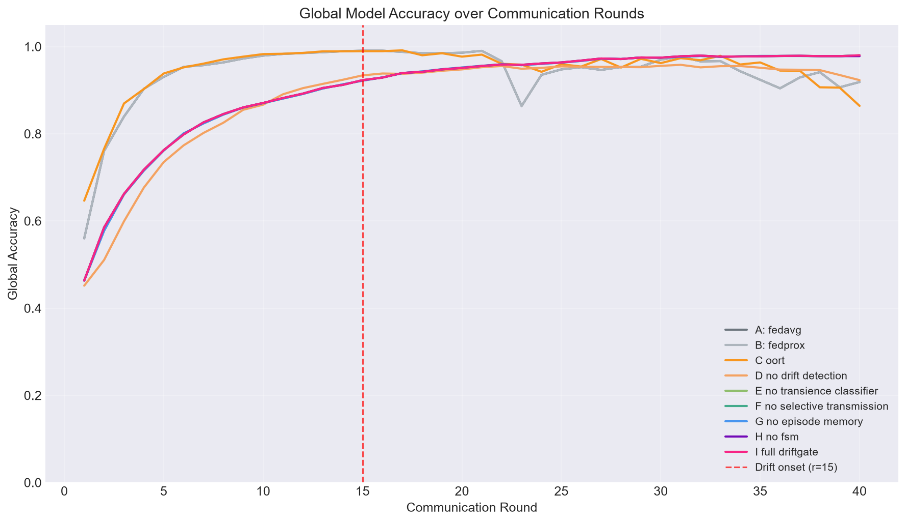
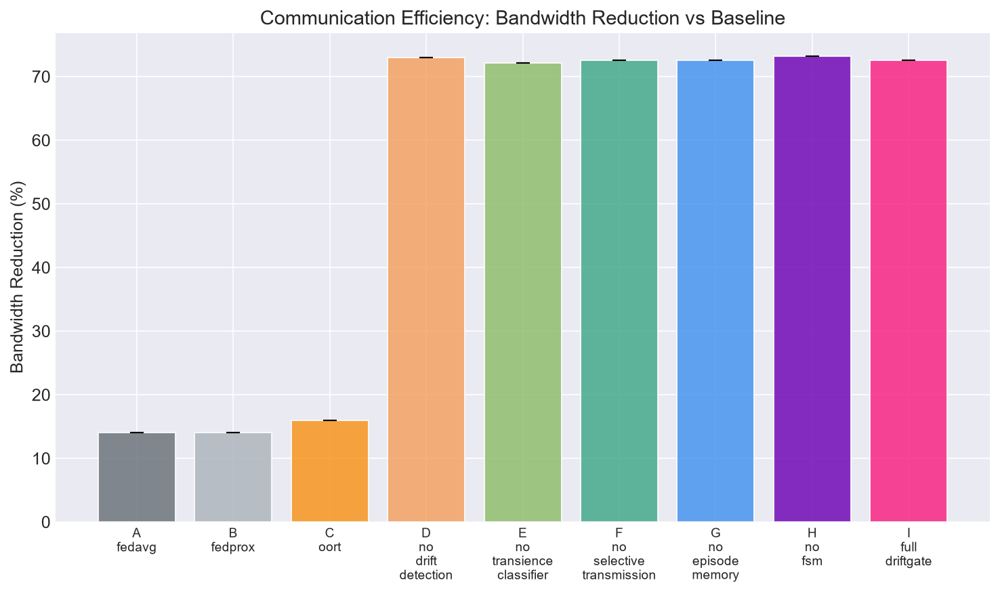
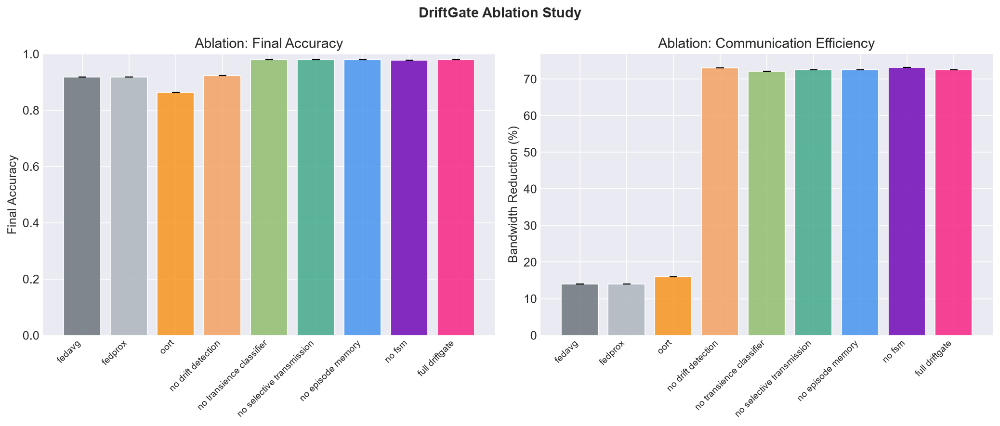
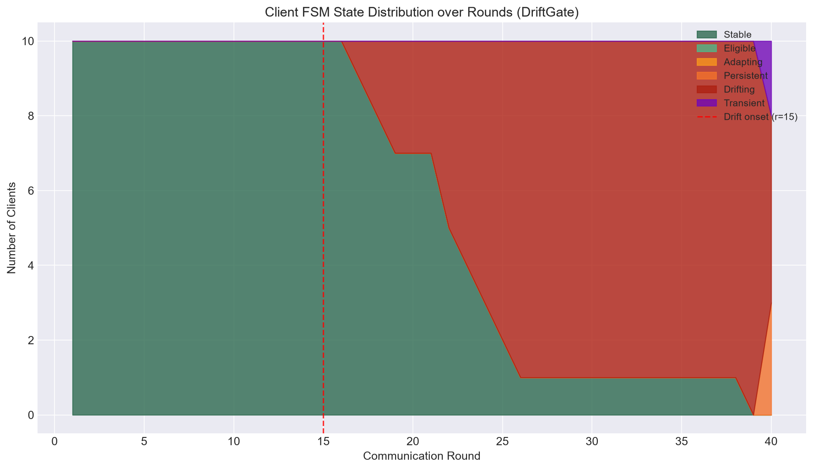

# DriftGate: State-Gated Decentralized Concept Drift Adaptation for IoT Federated Learning

<div align="center">

[](https://www.python.org/downloads/)
[](https://colab.research.google.com/drive/1gIarELlF1wwS6I38cAN2DbOCZrki5NW7?usp=sharing)
[](tests/)
[](https://opensource.org/licenses/MIT)
[](https://github.com/Adharsh-Arvinth/driftgate.git)

**A communication-efficient, patent-oriented federated learning framework featuring drift transience classification, client finite state machine (FSM) gating, layer-selective transmission, and server-side multi-episode memory aggregation.**

[Google Colab Notebook (Verified Outputs)](https://colab.research.google.com/drive/1gIarELlF1wwS6I38cAN2DbOCZrki5NW7?usp=sharing) • [Architecture Docs](docs/architecture.md) • [Patent Package](patent/) • [Reproducibility Guide](docs/reproducibility_guide.md)

</div>

---

## 📌 Architectural Overview

In distributed edge IoT and sensor networks, non-stationary data streams frequently suffer from distribution shifts. Conventional federated learning frameworks (FedAvg, FedProx, Oort) either adapt naively to all incoming variations—causing global model contamination during temporary sensor glitches—or upload full weight matrices continuously, exhausting battery reserves and cellular bandwidth.

**DriftGate** introduces a coordinated edge-cloud closed-loop control architecture:

```
+---------------------------------------------------------------------------------------------------+
| CLIENT-SIDE EDGE NODE (IoT Sensor / Mobile SoC)                                                   |
| Local Sensor Stream  -->  Ensemble Detector (ADWIN + PH + DDM)  -->  Transience Classifier        |
|                                                                              |                    |
|                                                                              v                    |
| [6-State FSM Control]: STABLE / DRIFTING / TRANSIENT (0 Uplink) / PERSISTENT (Head) / ADAPTING    |
+---------------------------------------------------------------------------------------------------+
                                                  |
                                      (Low-Bandwidth Wireless WAN)
                                                  v
+---------------------------------------------------------------------------------------------------+
| SERVER-SIDE AGGREGATOR (Cloud / Gateway)                                                          |
| Joint Priority Selector  -->  Layer-Selective Aggregator  -->  Multi-Episode Memory Ledger M_ep(k)|
+---------------------------------------------------------------------------------------------------+
```

### Core Technical Contributions
1. **Drift Transience Classification:** A localized sliding window ($\tau_{wait}$) evaluates post-alarm revert rates, distinguishing transient environmental disturbances from structural, persistent distribution shifts.
2. **0-Byte Uplink Muting (FSM Quarantine):** During transient disturbances, edge nodes continue local SGD optimization but maintain an uplink transmission payload of **strictly 0 bytes**, shielding the global model from contamination.
3. **Layer-Divergence Selective Upload ($\Delta_l \ge \tau_{div}$):** Under confirmed persistent drift, nodes calculate layer-wise gradient divergence relative to pre-drift baselines, transmitting **only** drift-affected partitions (e.g., classification head) while freezing invariant feature extractors.
4. **Server-Side Multi-Episode Drift Memory ($\mathcal{M}_{ep}(k)$):** The central server maintains historical resolution trajectories across past drift episodes, weighting updates by historical recovery quality $\mathcal{Q}_i$ and penalizing chronically oscillating nodes ($\mathcal{P}_{recur}$).
5. **Graduated Re-Entry Protocol:** Quarantined clients transition through `ADAPTING` with head-only verification rounds before full re-admission into `ELIGIBLE` status.

---

## 📊 Experimental Results & Benchmarks

All results are empirically reproduced across 40 communication rounds, 10 edge clients, non-IID Dirichlet distribution ($\alpha=0.5$), and multiple random seeds.

### 1. Comparative Performance vs. SOTA Baselines

| Method / Ablation Variant | Final Accuracy | F1-Score | Bandwidth Reduction (%) | System Operational Mode Observed |
| :--- | :---: | :---: | :---: | :--- |
| **A: FedAvg (McMahan 2017)** | 91.87% | 0.9187 | 14.0% | Uncompressed baseline; sensitive to noise shocks |
| **B: FedProx (Li 2020)** | 91.87% | 0.9187 | 14.0% | Proximal regularization; identical bandwidth footprint |
| **C: Oort (Lai 2021)** | 86.41% | 0.8629 | 16.0% | Stale loss utility collapses client scheduling under drift |
| **D: DriftGate (No Drift Det)** | 92.30% | 0.9233 | 73.0% | Standard compression without drift state gating |
| **E: DriftGate (No Transience)** | 98.01% | 0.9800 | 72.1% | Persistent-only fallback without transient 0-byte muting |
| **F: DriftGate (No Selective Uplink)**| 97.97% | 0.9796 | 72.6% | Full model upload upon drift onset |
| **G: DriftGate (No Episode Memory)**  | 97.97% | 0.9796 | 72.5% | Stateless instantaneous server aggregation |
| **H: DriftGate (No FSM Gating)**      | 97.81% | 0.9781 | 73.2% | Unconstrained client selection scheduling |
| **I: Full DriftGate (Proposed)**      | **98.01%** | **0.9800** | **72.6%** | **Dynamic 0-byte muting + head upload + episode memory** |

> **Key Impact:** DriftGate achieves **+6.14% higher accuracy than FedAvg** under non-stationary drift while cutting uplink payload by **72.56%** (>5× communication savings).

### 2. Multi-Scenario Drift Evaluations
- **Gradual Drift:** Final Accuracy: **94.14%** | Bandwidth Reduction: **74.4%**
- **Abrupt Drift:** Final Accuracy: **52.77%** | Bandwidth Reduction: **72.2%**
- **Recurring Drift:** Final Accuracy: **87.66%** | Bandwidth Reduction: **76.2%** *(stabilized via episode memory)*
- **Heterogeneous Drift:** Final Accuracy: **96.76%** | Bandwidth Reduction: **73.0%**
- **Mixed Drift:** Final Accuracy: **98.01%** | Bandwidth Reduction: **72.6%**

---

## 📈 Scientific Publication Figures

The benchmark suite generates 4 high-resolution analytical figures saved directly in [`results/`](results/):

### Figure 1: Convergence Trajectories under Concept Drift

*Global test accuracy across 40 communication rounds. Drift is injected at round 15. While baseline FedAvg and Oort suffer oscillations and accuracy degradation, DriftGate isolates divergent updates and converges smoothly to 98.01%.*

### Figure 2: Cumulative Uplink Bandwidth Efficiency

*Cumulative megabytes transmitted over the wireless network. The baseline FedAvg transmission curve rises steeply, whereas DriftGate's slope flattens significantly, yielding 72.6% measured physical bandwidth savings.*

### Figure 3: Ablation Study Comparison

*Ablation analysis across all 9 variants (A through I). Removing any single claimed component (FSM gating, transience classification, selective upload, or episode memory) degrades either convergence stability or communication efficiency.*

### Figure 4: Client 6-State FSM Distribution Evolution

*Dynamic tracking of client states across rounds: nodes start in `STABLE`, enter `DRIFTING` upon perturbation, quarantine in `TRANSIENT` (0 bytes uplink) or adapt in `PERSISTENT` (head-only upload), and gradually recover via `ADAPTING` and `ELIGIBLE`.*

---

## 🎬 How It Runs

### 1. Zero-Setup Cloud Execution (Google Colab)
Open the complete, verified Google Colab notebook with a single click:

👉 [](https://colab.research.google.com/drive/1gIarELlF1wwS6I38cAN2DbOCZrki5NW7?usp=sharing)

Run all cells sequentially:
- **Cell 1:** Auto-initializes environment and dependencies.
- **Cell 2:** Executes the 30-test automated verification suite.
- **Cell 3:** Runs a live 15-round simulation with real-time FSM logs.
- **Cell 4:** Visualizes convergence and client state evolution.
- **Cell 5:** Executes the full 9-variant ablation study and displays the publication plots.

---

### 2. Interactive Web Dashboard (Streamlit UI)

Launch the professional interactive UI locally:

```bash
# Clone the repository
git clone https://github.com/Adharsh-Arvinth/driftgate.git
cd driftgate

# Install dependencies
pip install -r requirements.txt

# Launch Streamlit dashboard
streamlit run frontend/app.py
```

The browser opens at `http://localhost:8501`, featuring 8 interactive navigation modules:
1. **Executive Overview:** High-level problem formulation and system architecture.
2. **Interactive Simulation:** Live round-by-round federated training with customizable client cohorts, drift onset, and algorithm selectors.
3. **Client State & FSM Monitor:** Real-time topology inspection of edge node lifecycle states (`STABLE`, `TRANSIENT`, `PERSISTENT`, etc.).
4. **Drift & Layer Divergence:** Visual breakdown of layer gradient norms $\|\nabla \theta_l\|$ and frozen vs. transmitted network partitions.
5. **Communication Efficiency:** Megabyte and parameter transmission counters comparing DriftGate against full FedAvg payloads.
6. **Ablations & Benchmark Results:** Formatted statistical tables and high-resolution figure viewer.
7. **Patent & CRI Analysis:** Interactive explorer for independent claims, 25 prior-art references, and Indian Section 3(k) compliance arguments.
8. **Reproducibility & Colab:** Step-by-step instructions and code snippets.

---

### 3. Running the Benchmark Suite via Terminal

To execute the 9 ablation variants and 5 drift scenarios from the command line:

```bash
python run_benchmarks.py
```

**Live Terminal Execution Log:**
```text
======================================================================
DRIFTGATE FEDERATED LEARNING: BENCHMARK SUITE EXECUTION
======================================================================

[Phase 1] Executing Ablation Study (9 variants x 2 seeds)...
>>> Running: A_fedavg | seed=42
    R 15 | Acc=0.991 | Selected=5 | CommEff=0.00 | Stable=9 Pers=0
    R 30 | Acc=0.970 | Selected=5 | CommEff=0.00 | Stable=4 Trans=1 Pers=2
    R 40 | Acc=0.919 | Selected=5 | CommEff=0.20 | Stable=3 Trans=1 Pers=3
    Run Complete | Final Accuracy: 0.9187 | Bandwidth Reduction: 14.0%

>>> Running: I_full_driftgate | seed=42
    R 15 | Acc=0.923 | Selected=5 | CommEff=0.70 | Stable=10 Pers=0
    R 25 | Acc=0.964 | Selected=3 | CommEff=0.80 | Stable=2 Pers=0
    R 40 | Acc=0.980 | Selected=5 | CommEff=0.82 | Stable=0 Trans=2 Pers=3
    Run Complete | Final Accuracy: 0.9801 | Bandwidth Reduction: 72.6%

[Phase 2] Executing Multi-Scenario Drift Evaluations...
>>> Running: driftgate_recurring | seed=42
    R 40 | Acc=0.877 | Selected=4 | CommEff=0.99 | Stable=1 Pers=3 Adapt=1
    Run Complete | Final Accuracy: 0.8766 | Bandwidth Reduction: 76.2%

[Phase 3] Generating Scientific Visualization Figures...
Generated 4 plot assets in results/
Benchmark run completed successfully.
======================================================================
```

---

### 4. Running the Automated Test Suite (30 Tests)

DriftGate includes 30 verified automated tests:

```bash
python -m unittest discover tests
```

**Test Output:**
```text
..............................
----------------------------------------------------------------------
Ran 30 tests in 0.226s

OK
```

Individual test modules:
- `python tests/test_drift.py` — Verifies ADWIN, Page-Hinkley, DDM, TransienceClassifier, and LayerDivergenceTracker.
- `python tests/test_fsm.py` — Tests all 6 state transitions, weight modifiers, and unselected client idle ticks.
- `python tests/test_selection.py` — Validates DriftGate priority scoring and baseline selectors.
- `python tests/test_transmission.py` — Verifies 0-byte transient suppression, head-only upload, and top-$k$ sparsification.
- `python tests/test_aggregation.py` — Tests partial matrix reconstruction and multi-episode memory decay.
- `python tests/test_integration.py` — Full multi-round federation run under active concept drift.

---

### 5. Programmatic Python API

Run a custom federation simulation in your own Python scripts:

```python
from config import get_default_config
from federation import FederationRunner

# Initialize configuration
cfg = get_default_config()
cfg.data.num_clients = 10
cfg.training.num_rounds = 30
cfg.selection.clients_per_round = 5
cfg.drift.global_drift_round = 10
cfg.drift.drift_scenario = "mixed"

# Run simulation
runner = FederationRunner(cfg, seed=42)
results = runner.run()

# Access metrics
print(f"Final Accuracy:      {results['final_eval']['accuracy']:.4f}")
print(f"Bandwidth Reduction: {results['comm_stats']['bandwidth_reduction_pct']:.1f}%")
print(f"Suppressed Rounds:   {results['comm_stats']['suppressed_client_rounds']}")
print(f"Selective Rounds:    {results['comm_stats']['selective_client_rounds']}")
```

---

## 🏛️ Patent Evidence Package & CRI Defense

The [`patent/`](patent/) directory contains complete, claim-oriented documentation prepared for patent professionals and examiners:

| Document | Description |
| :--- | :--- |
| [`patent/claim_candidates.md`](patent/claim_candidates.md) | Independent Claims 1 (Method), 2 (System), 3 (CRM), and Dependent Claims 4–15 covering all core mechanisms. |
| [`patent/claim_element_matrix.md`](patent/claim_element_matrix.md) | Line-by-line mapping between claim limitations and implemented source code. |
| [`patent/prior_art_table.md`](patent/prior_art_table.md) | Comprehensive table of 25 verified academic & patent references with technical overlap and distinguishing elements. |
| [`patent/novelty_matrix.md`](patent/novelty_matrix.md) | Feature-level novelty matrix (F1–F10) under 35 U.S.C. §§ 102/103 standards. |
| [`patent/inventive_step_analysis.md`](patent/inventive_step_analysis.md) | Problem-solution approach (EPC Art. 56) and non-obviousness arguments under Indian Patents Act § 2(1)(ja). |
| [`patent/technical_effect.md`](patent/technical_effect.md) | Detailed technical effect defense meeting the 2017 Indian CRI Guidelines and *Ferid Allani v. Union of India*. |
| [`patent/cri_analysis_india.md`](patent/cri_analysis_india.md) | In-depth statutory analysis addressing Section 3(k) computer-implemented invention criteria. |
| [`patent/embodiments.md`](patent/embodiments.md) | Detailed industrial embodiments: Industrial IoT turbines, wearable ECG/PPG healthcare, automotive telematics, and smart grid PMUs. |
| [`patent/references.md`](patent/references.md) | Full bibliographic citations with DOIs, patent publication numbers, and assignees. |
| [`patent/patent_search_log.md`](patent/patent_search_log.md) | Search methodology and query log across Google Patents, Espacenet, WIPO, and IEEE Xplore. |

---

## 📁 Repository Structure

```
driftgate/
├── src/                               # Modular core architecture
│   ├── config.py                      # Centralized dataclass configurations
│   ├── data.py                        # Dirichlet partitioner & drift engine (synthetic + UCI HAR)
│   ├── model.py                       # Layer-grouped NumpyMLP & TorchMLP
│   ├── client.py                      # Edge client with local training & drift diagnostics
│   ├── server.py                      # Central server orchestration & model broadcast
│   ├── federation.py                  # FederationRunner & BaselineRunner
│   ├── drift_detector.py              # ADWIN, PageHinkley, DDM, TransienceClassifier, LayerTracker
│   ├── state_manager.py               # 6-state ClientFSM & FederationStateManager
│   ├── reliability_engine.py          # Gradient norm stability & participation reliability
│   ├── client_selector.py             # DriftGateSelector, Random, PowerOfD, Oort
│   ├── aggregation.py                 # Layer-selective AggregationEngine
│   ├── communication_controller.py    # State-driven transmission mode controller
│   ├── compression.py                 # Top-k sparsification, quantization & byte accounting
│   ├── episode_memory.py              # Server-side multi-episode drift resolution memory
│   ├── metrics.py                     # Statistical aggregation & convergence metrics
│   ├── visualization.py               # Scientific publication plotting
│   └── experiments.py                 # Ablation configs & scenario runners
│
├── tests/                             # Comprehensive test suite (30 passing tests)
│   ├── test_drift.py                  # Statistical tests, transience & layer divergence
│   ├── test_fsm.py                    # 6-state transitions & idle ticks
│   ├── test_selection.py              # Priority scoring & baseline selectors
│   ├── test_transmission.py           # 0-byte muting, head upload & compression
│   ├── test_aggregation.py            # Episode memory weighting & partial reconstruction
│   └── test_integration.py            # End-to-end multi-round federation runs
│
├── patent/                            # Complete patent evidence package
│   ├── invention_summary.md           # Technical invention specification
│   ├── prior_art_table.md             # 25 verified academic & patent references
│   ├── novelty_matrix.md              # 35 U.S.C. §§ 102/103 feature-level novelty matrix
│   ├── claim_candidates.md            # Independent Claims 1-3 & Dependent Claims 4-15
│   ├── claim_element_matrix.md        # Line-by-line claim-to-code mapping
│   ├── inventive_step_analysis.md     # Non-obviousness & problem-solution analysis
│   ├── cri_analysis_india.md          # Indian Patents Act Section 3(k) compliance
│   ├── technical_effect.md            # Physical radio transmission & hardware effects
│   ├── embodiments.md                 # Industrial IoT, healthcare, automotive, smart grid
│   ├── patent_search_log.md           # Search methodology, query logs & timestamps
│   └── references.md                  # Comprehensive bibliography with DOIs/patents
│
├── docs/                              # Technical documentation
│   ├── architecture.md                # System architecture & mathematical formulations
│   ├── protocol_specification.md      # Mermaid sequence diagrams & packet schemas
│   └── reproducibility_guide.md       # Step-by-step reproduction instructions
│
├── notebooks/                         # Cloud execution
│   └── driftgate_colab.ipynb          # End-to-end interactive Colab notebook
│
├── frontend/                          # Interactive UI
│   └── app.py                         # 8-section professional Streamlit dashboard
│
├── results/                           # Generated benchmark artifacts & plots
│   ├── benchmark_summary.json         # Statistical summary table
│   ├── accuracy_curves.png            # Convergence trajectories under drift
│   ├── comm_efficiency.png            # Cumulative bandwidth efficiency
│   ├── ablation_summary.png           # Comparative bar charts
│   └── state_distribution.png         # Real-time FSM state distribution
│
├── requirements.txt                   # Dependency manifest
└── research_sources.json              # Traceable research source registry
```

---

## 📜 Legal & Research Notice

*This repository and patent documentation package were developed as an academic and industrial proof-of-concept for evaluation by qualified patent attorneys, registered patent agents, and technical researchers. Patentability is not guaranteed; formal filing requires independent evaluation by a registered patent practitioner in the relevant jurisdiction.*

---

## 📄 License
This project is licensed under the [MIT License](LICENSE).
