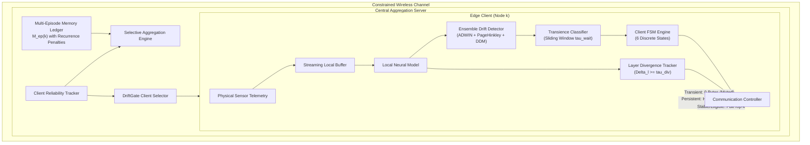

# DriftGate: System Architecture & Mathematical Formulation

## 1. High-Level Architecture Overview

DriftGate is a decentralized, state-gated federated learning framework designed for non-stationary, non-IID edge IoT sensor environments. It solves the dual challenges of **concept drift degradation** and **communication bandwidth constraints** through coordinated edge-cloud mechanisms.

---

## 2. Core Mathematical Formulations

### 2.1 Layer-Gradient Divergence Ratio ($\Delta_l$)
For model layer $l \in \{1, \dots, L\}$, with local gradient $\nabla \theta_l^{(k)}$ and empirical moving baseline norm $\|\nabla \theta_l^{base}\|$, the layer divergence score is:
$$\Delta_l^{(k)} = \frac{\|\nabla \theta_l^{(k)}\|_2}{\|\nabla \theta_l^{base}\|_2 + \epsilon}$$

A layer group $g$ is declared drift-affected if:
$$\max_{l \in g} \Delta_l^{(k)} \ge \tau_{div}$$

### 2.2 Client-Side 6-State Finite State Machine (FSM)
The client state $\mathcal{S}_k \in \{\text{STABLE}, \text{DRIFTING}, \text{TRANSIENT}, \text{PERSISTENT}, \text{ADAPTING}, \text{ELIGIBLE}\}$ transitions according to:

$$\mathcal{S}_k^{(t+1)} = \begin{cases}
\text{DRIFTING}, & \text{if } \mathcal{S}_k^{(t)} = \text{STABLE} \land \text{alarm}(t) = \text{True} \\
\text{TRANSIENT}, & \text{if } \mathcal{S}_k^{(t)} = \text{DRIFTING} \land t_{wait} \ge \tau_{wait} \land \text{revert\_ratio} \ge \tau_{revert} \\
\text{PERSISTENT}, & \text{if } \mathcal{S}_k^{(t)} = \text{DRIFTING} \land t_{wait} \ge \tau_{wait} \land \text{sustain\_ratio} \ge \tau_{persist} \\
\text{ADAPTING}, & \text{if } \mathcal{S}_k^{(t)} = \text{PERSISTENT} \land \text{alarm}(t) = \text{False} \land t_{pers} \ge \tau_{min\_pers} \\
\text{ELIGIBLE}, & \text{if } \mathcal{S}_k^{(t)} = \text{ADAPTING} \land \text{Acc}_k \ge \tau_{recovery} \\
\text{STABLE}, & \text{if } \mathcal{S}_k^{(t)} = \text{ELIGIBLE} \land \text{alarm}(t) = \text{False}
\end{cases}$$

### 2.3 Server-Side Multi-Episode Historical Resolution Weight ($\mathcal{M}_{ep}(k)$)
Let client $k$ have a historical sequence of closed drift episodes $\mathcal{E}_k = \{e_1, e_2, \dots, e_E\}$. For episode $e_i$ with normalized recovery quality $\mathcal{Q}_i \in [0, 1]$ and recurrence indicator $\rho_i \in \{0, 1\}$, the memory weight is:
$$\mathcal{M}_{ep}(k) = \frac{\sum_{i=1}^E \lambda^{E-i} \cdot \mathcal{Q}_i \cdot (1 - \beta \cdot \rho_i)}{\sum_{i=1}^E \lambda^{E-i}}$$
where $\lambda \in (0, 1]$ is the temporal recency decay factor and $\beta \in [0, 1)$ is the recurrence penalty factor.

### 2.4 Joint Global Model Aggregation
For each parameter tensor $\theta_l$:
$$\theta_{global, l}^{(t+1)} = \theta_{global, l}^{(t)} + \frac{\sum_{k \in \mathcal{K}_l} w_k \cdot \Delta \theta_{k, l}^{(t)}}{\sum_{k \in \mathcal{K}_l} w_k}$$
where $\mathcal{K}_l$ is the set of clients transmitting layer $l$, and the composite client weight $w_k$ is:
$$w_k = n_k \cdot \mathcal{M}_{ep}(k) \cdot \mathcal{R}_k \cdot \Phi_{FSM}(\mathcal{S}_k)$$
with local sample count $n_k$, reliability score $\mathcal{R}_k$, and state aggregation modifier $\Phi_{FSM}$.
