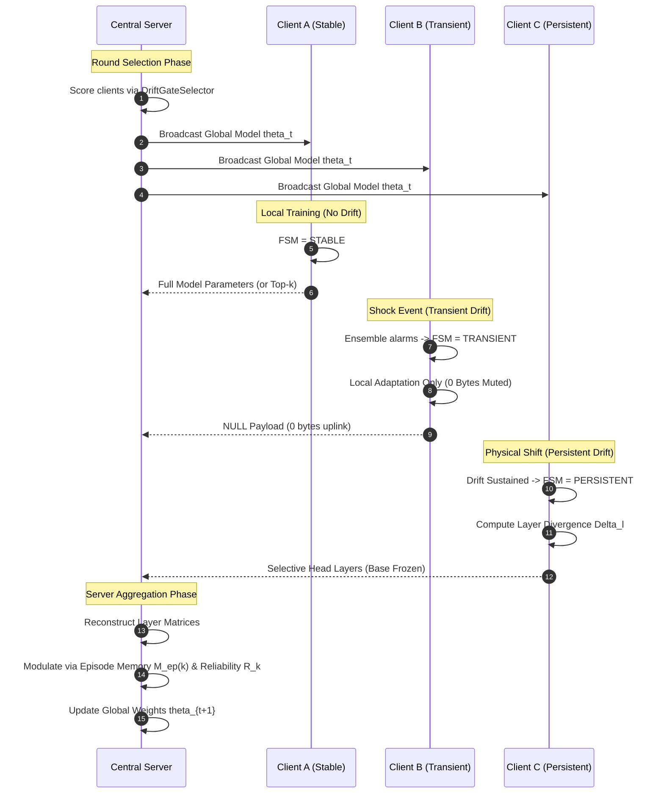

# DriftGate: Protocol Specification & Message Flow

This document details the exact communication protocol, sequence diagrams, and data payload schemas executed between edge nodes and the central aggregation server.

---

## 1. Sequence Diagrams

### 1.1 Round Sequence: Transient Drift vs. Persistent Adaptation



---

## 2. Message Payload Schemas

### 2.1 Server-to-Client: Round Broadcast
```json
{
  "round_number": 42,
  "global_parameters": {
    "W_base_0": "<base64_encoded_float32_array>",
    "b_base_0": "<base64_encoded_float32_array>",
    "W_head_1": "<base64_encoded_float32_array>",
    "b_head_1": "<base64_encoded_float32_array>"
  },
  "layer_groups": {
    "base": [0, 1],
    "head": [2, 3]
  },
  "learning_rate": 0.01
}
```

### 2.2 Client-to-Server: Client Result Uplink

#### Case A: Stable / Eligible Node
```json
{
  "client_id": 0,
  "transmission_mode": "full",
  "fsm_state": "stable",
  "transmitted_parameters": {
    "W_base_0": "<tensor>",
    "b_base_0": "<tensor>",
    "W_head_1": "<tensor>",
    "b_head_1": "<tensor>"
  },
  "n_samples": 128,
  "local_accuracy": 0.88,
  "local_loss": 0.35,
  "drift_signal": "stable"
}
```

#### Case B: Transient Node (Suppressed)
```json
{
  "client_id": 1,
  "transmission_mode": "none",
  "fsm_state": "transient",
  "transmitted_parameters": null,
  "payload_bytes": 0,
  "n_samples": 128,
  "local_accuracy": 0.62,
  "drift_signal": "drift",
  "drift_type": "transient"
}
```

#### Case C: Persistent Node (Layer-Selective)
```json
{
  "client_id": 2,
  "transmission_mode": "selective",
  "fsm_state": "persistent",
  "affected_layer_groups": ["head"],
  "transmitted_parameters": {
    "W_head_1": "<tensor>",
    "b_head_1": "<tensor>"
  },
  "divergence_scores": {
    "0": 0.04,
    "1": 0.08,
    "2": 3.85,
    "3": 4.12
  },
  "n_samples": 128,
  "local_accuracy": 0.74,
  "drift_signal": "drift",
  "drift_type": "persistent"
}
```

---

## 3. Finite State Machine (FSM) State Transition Matrix

| Current State | Input Event / Condition | Action Taken | Next State | Transmission Mode |
|:---|:---|:---|:---|:---|
| **STABLE** | Drift alarm triggered | Start classification timer | **DRIFTING** | None (Awaiting verification) |
| **DRIFTING** | Reverts within $\tau_{wait}$ | Flag transient shock | **TRANSIENT** | None (0 bytes muted) |
| **DRIFTING** | Sustained across $\tau_{wait}$ | Measure $\Delta_l$ divergence | **PERSISTENT** | Selective (Head only) |
| **TRANSIENT** | $\tau_{suppress}$ rounds elapsed | Check sensor baseline | **STABLE** | Full (or top-k) |
| **TRANSIENT** | Relapse / sustained error | Elevate to persistent | **PERSISTENT** | Selective (Head only) |
| **PERSISTENT** | Drift resolved ($\tau_{min\_pers}$) | Initiate local fine-tuning | **ADAPTING** | Selective (Head only) |
| **ADAPTING** | $\text{Acc} \ge \tau_{recovery}$ | Quarantine cleared | **ELIGIBLE** | Full (or top-k) |
| **ELIGIBLE** | Confirmed stable round | Normal participation | **STABLE** | Full (or top-k) |
